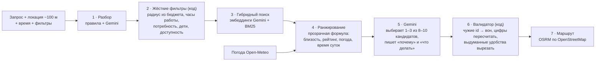

<div align="center">

# 🗺️ Seruen

### Куда сходить в Астане — прямо сейчас

**ИИ-помощник по прогулкам: 1–3 реальных места рядом, почему именно они, сколько идти, что там делать и насколько мы уверены, что место открыто.**

*Seruen — от казахского «серуен», «прогулка».*

[**▶ Открыть демо**](https://seruen-hsvmox55fa-ew.a.run.app) · [Концепция](docs/CONCEPT.md) · [Как работает RAG](docs/RAG.md) · [Тестовые сценарии](docs/TEST_SCENARIOS.md) · [Этика и приватность](docs/ETHICS_PRIVACY.md)


*Хакатон **Build with AI** · задача №1 **НИЦ Smart City** · партнёры GDG Astana*

</div>

---

## ✨ Зачем

Карты показывают сотни точек, но не отвечают на вопрос **«что мне сделать за свободный час?»**. Чат-боты отвечают связно, но **выдумывают места**, не знают, открыто ли сейчас, и не считают расстояние. А в Астане погода — главный контекст: совет «прогуляйтесь по набережной» при −25 °C просто вреден.

**Seruen** отвечает на запрос своими словами — на русском, казахском или английском — и показывает:

| | |
|---|---|
| 📍 **1–3 места рядом** | только из реальной базы, на карте, с мини-маршрутом |
| 💬 **Почему именно они** | короткое объяснение, опирающееся на факты из данных |
| 🚶 **Сколько идти и что делать** | расстояние и время считает код, план на месте — Gemini |
| 🕒 **Открыто ли** | «Открыто до 22:00» / «Вероятно открыто (часы по OSM)» / «Часы неизвестны — уточните» |
| 🧭 **Как добраться** | кнопки «Вести в навигаторе»: Яндекс Карты, 2GIS, Google Maps |
| 🔍 **Что учтено** | огрублённая локация, время, погода, фильтры — всё на виду |

## 🎬 Сценарии

| Запрос | Что делает Seruen |
|---|---|
| «Я у Mega Silk Way, хочу прогуляться 30–60 минут» | 2–3 парка и бульвара рядом, маршрут укладывается в бюджет; сам ТРЦ, где вы стоите, не предлагает |
| «Вечер, на улице −20» | Только тёплые места, короткие переходы, в объяснении — «в мороз под крышей» |
| «2 часа до вылета» | Режим такси, запас 1 ч на регистрацию, честно: «в центр не успеть — вот что ближе» |
| «Еду с ребёнком» | Площадки, интерактивные музеи, детские зоны; бары и взрослые места отсеяны |
| «Ищу необычное ночью» | Только открытое в 23:00+, освещённое и людное; закрытое скрыто |
| «Хочу в бассейн» / «где ближайший Магнум?» / «аптека ночью» | **Только** подходящие места; рядом нет — «ближайший в 5 км на такси»; в базе нет — честное «нет мест для: …», без кафе-заглушек |
| «Залезть на крышу ночью» | Предупреждение о безопасности и 112, легальные видовые места взамен |

## 🧠 Как это работает

Главный принцип: **LLM не придумывает места и не считает цифры.** Факты — из базы и кода, Gemini понимает запрос и объясняет выбор человеческим языком.



- **Нулевые галлюцинации мест:** генерация видит только прошедших фильтр кандидатов, валидатор удаляет всё остальное и вырезает удобства, которых нет в данных места.
- **Честность:** «открыто» пишем только при подтверждённых часах; всё, что придумал ИИ, идёт отдельным блоком «идея ИИ».
- **Работает без LLM:** если Gemini недоступен или упёрся в лимит — ответ по ранжированию с шаблонными объяснениями, а не ошибка.
- Подробно: [docs/RAG.md](docs/RAG.md), [backend/README.md](backend/README.md).

## 📊 Данные и качество

| Данные | |
|---|---|
| Мест в базе | **3000+** (OSM + Wikidata/Википедия + официальный API 2GIS), открытая выгрузка без 2GIS — 2500+ |
| Категорий | 28: от музеев и парков до бассейнов, аптек и магазинов 24/7 |
| Сбор | автоматический, одной командой: `python pipeline/run_all.py` |
| Фото | только Wikimedia Commons, с автором и лицензией |

| Качество — авто-оценка на 38 сценариях ([отчёт](eval/report.md)) | |
|---|---|
| **Релевантность**: «бассейн → бассейн, а не суши» | **100 %** запросов и мест по теме |
| «Открыто» без данных о часах | **0** случаев |
| Язык ответа = язык запроса (ru / kk / en) | **100 %** |
| Задержка с Gemini | медиана ~3 с |

## 🔒 Приватность и этика

- Координаты **огрубляются до ~100 м прямо в браузере**, на сервере не пишутся в логи и не хранятся. Аккаунт не нужен.
- Погода запрашивается **по центру города**, а не по точке пользователя.
- Факт из базы и идея ИИ **визуально разделены**; у каждого места — источник и уровень уверенности.
- Опасные запросы → предупреждение и **112**; ночью — только людные освещённые места.
- Подробно: [docs/ETHICS_PRIVACY.md](docs/ETHICS_PRIVACY.md).

## 🚀 Запуск

**Готовое демо:** https://seruen-hsvmox55fa-ew.a.run.app

**Локально** (Python 3.12, Node 22):

```bash
cp .env.example .env   # вписать GEMINI_API_KEY; без ключа сервис тоже работает — в режиме без ИИ
```
```bash
python3.12 -m venv .venv && .venv/bin/pip install -r backend/requirements.txt
```
```bash
.venv/bin/uvicorn backend.app.main:app --reload --reload-dir backend --port 8000
```
```bash
cd frontend && npm ci && npm run dev   # http://localhost:5173
```

Тесты и авто-оценка:
```bash
.venv/bin/python -m pytest backend/tests -q
```
```bash
python3 eval/run_eval.py --delay 13
```

**Деплой** в Google Cloud Run одной командой — [deploy/README.md](deploy/README.md).

## 🗂️ Структура

| Папка | Что внутри |
|---|---|
| [`pipeline/`](pipeline/) · `data/` | Автоматический сбор POI: OSM Overpass, Wikidata/Википедия, 2GIS API → нормализация, дедупликация, валидация по схеме |
| [`backend/`](backend/) | FastAPI: разбор → фильтры → гибридный поиск → ранжирование → Gemini → валидатор → маршрут |
| [`frontend/`](frontend/) | React + Vite + Leaflet: карта + чат, пресеты, ползунок времени, кнопки навигатора, три языка |
| [`contracts/`](contracts/) | Общий контракт: `api.md`, `poi.schema.json` |
| [`docs/`](docs/) · [`eval/`](eval/) | Концепция, RAG, этика, ограничения · 38 тестовых сценариев и авто-оценка |
| [`deploy/`](deploy/) | Cloud Run: один сервис — API + собранный фронтенд |

## 🛣️ Дальше

Афиши и события → дашборд обезличенного спроса для НИЦ Smart City (районы × категории × время × погода, без координат людей) → офлайн-режим и голосовой ввод на казахском → интеграция с городскими сервисами → Алматы и Шымкент: конвейер данных автоматический, новый город подключается за день.

## 📜 Данные и лицензии

OpenStreetMap — © участники OSM, ODbL · Wikidata — CC0 · Википедия — CC BY-SA 4.0 · фото — Wikimedia Commons (CC0 / PD / CC BY / CC BY-SA, с атрибуцией) · 2GIS — только через официальный API, в репозиторий не входит. Подробно: [data/LICENSE_DATA.md](data/LICENSE_DATA.md).

<div align="center">

**Seruen** — чтобы в Астане было куда пойти в любую погоду.

</div>
