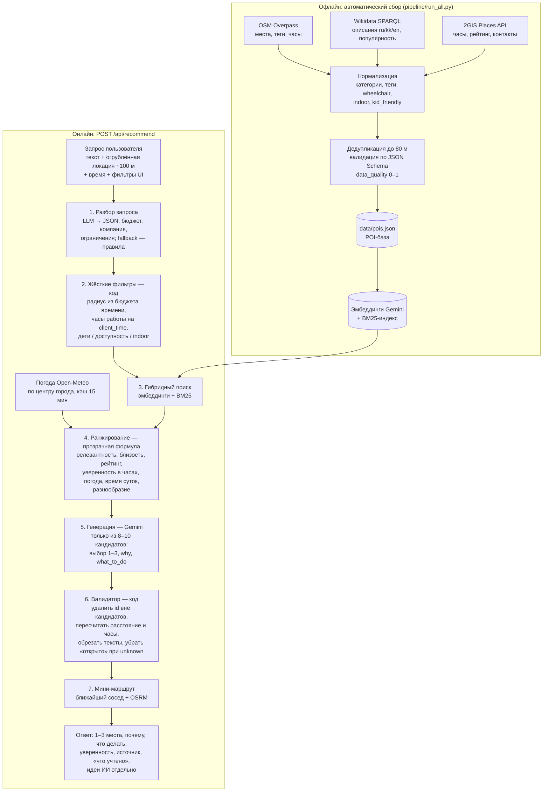

# Как работает RAG в «Серуене»

*Build with AI · задача НИЦ Smart City. Google-стек: генерация, разбор запроса и эмбеддинги — **Gemini (Google AI)**; маршруты — по открытым данным OSM (OSRM).*

Главный принцип: **LLM не придумывает места и не считает цифры.** Факты (какие места есть, где они, открыты ли, сколько идти) — из базы и кода. LLM делает то, что умеет лучше всего: понимает запрос и объясняет выбор человеческим языком.

## Схема

## Этапы

| Этап | Кто делает | Что происходит | Зачем так |
|---|---|---|---|
| Сбор данных | Код, по расписанию | OSM + Wikidata + 2GIS → нормализация → `data/pois.json` — 3063 POI (полная база с 2GIS) и `data/pois_open.json` — 2578 POI (открытая выгрузка OSM + Wikidata/Википедия) | Автоматизация обязательна; только открытые данные и официальные API |
| Разбор запроса | LLM (JSON-режим, низкая температура) | «30–60 минут», «с ребёнком», «розетка», «вылет» → структура | Явные фильтры UI важнее; без LLM работают правила-регулярки |
| Жёсткие фильтры | Код | Радиус = дорога в одну сторону ≤ ⅓ бюджета (для прогулки ≤ 45 %); закрытые на момент визита — вон; дети/кресло/помещение | Гарантии нельзя доверять LLM |
| Гибридный поиск | Код | Косинус по эмбеддингам Gemini + BM25 по названию, категории, тегам, описанию | Смысл («необычное») + точные слова («розетка») |
| Ранжирование | Код | `score = 0.40·релевантность + 0.20·ограничения + 0.15·близость + 0.10·рейтинг + 0.05·качество данных + 0.10·уверенность в часах + 0.10·погода + 0.10·время суток`, штраф за повтор категории | Формула прозрачна и настраивается без переобучения |
| Генерация | LLM (Gemini) | Видит только кандидатов с фактами, расстоянием и часами; пишет `why` ≤ 200 и `what_to_do` ≤ 250 символов на языке пользователя | LLM объясняет, но не выбирает из воздуха |
| Валидатор | Код | Выбрасывает чужие `poi_id`, пересчитывает `distance_m`/`travel_min`/`open_status`, режет длину, убирает «открыто» без данных; если пусто — top-3 ранжирования с шаблонным `why` | Нулевые галлюцинации по местам и цифрам |
| Маршрут | Код | Порядок «ближайший сосед», проверка бюджета, геометрия OSRM (иначе прямые и пометка) | Мини-маршрут из 2–3 мест |

## Погода — фишка Астаны
Open-Meteo (без ключа) по центру города — координаты пользователя никуда не уходят. Ниже −10 °C или ветер > 10 м/с: места в помещении получают буст, открытые — штраф, переходы короче. Летом в жару — наоборот, тень и вода. В ответе пользователь видит: «Учтено: −18 °C, ветер 12 м/с → предпочли места в помещении».

## Уверенность в часах работы
| Источник часов | Уверенность | Что видит пользователь |
|---|---|---|
| 2GIS / официальный сайт, проверено ≤ 30 дней | high | «Открыто до 22:00» |
| OSM | medium | «Вероятно открыто (часы по OSM, проверено …)» |
| Нет данных или устарели | low, `state=unknown` | «Часы неизвестны — уточните» + warning |

## Почему именно так
- **Нет галлюцинаций мест**: генерация получает только кандидатов, валидатор отсекает всё остальное (eval, 38 сценариев: 0 выдуманных мест, 0 закрытых, релевантность 47/47 мест).
- **Цифры считает код**: расстояние (haversine × 1,3 на извилистость, 4,5 км/ч пешком), время, часы — детерминированно и проверяемо.
- **Работает без LLM**: при недоступности Gemini — правила + ранжирование + шаблонные объяснения (режим деградации, не ошибка 500).
- **Отделение фактов от идей**: всё, что LLM придумал сам («выпейте горячий шоколад»), идёт в `ideas` с пометкой «идея ИИ».
- **Быстро**: цель < 5 с; эмбеддинги базы и запросов кэшируются (eval с Gemini: медиана 3,2 с, p95 6,9 с; бюджет LLM 6 с, дальше — ответ без ИИ с пометкой).

## Стек
- **Google AI — Gemini**: разбор запроса (JSON-режим), генерация объяснений, эмбеддинги POI и запросов (Gemini Embedding). Провайдер вынесен в абстракцию, в финале — только Gemini.
- **Открытые данные**: OpenStreetMap (база и маршруты через OSRM), Wikidata, Open-Meteo; 2GIS — через официальный API.
- **Фото мест**: поле `image` — только Wikimedia Commons (Wikidata P18 / OSM), лицензии CC0, PD, CC BY, CC BY-SA, с автором и лицензией в карточке. Фото из 2GIS/Google не берём; без фото — иллюстрация категории с пометкой.
- Python 3.12, FastAPI · rank_bm25, numpy · React + Vite + Leaflet.
